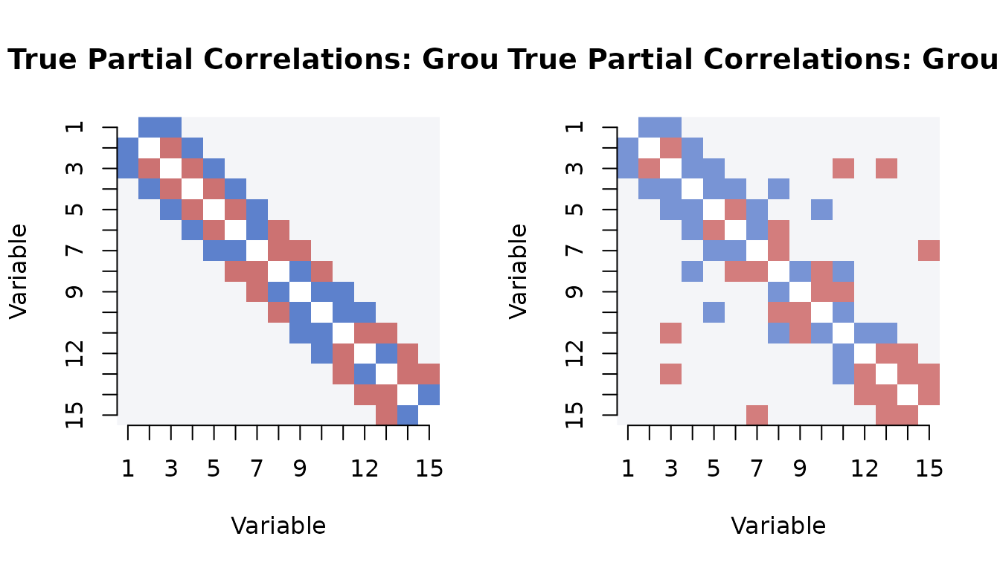
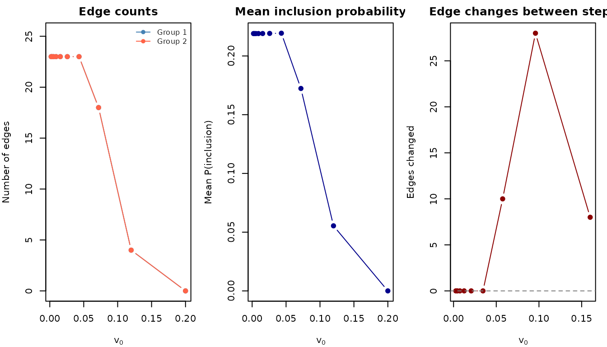
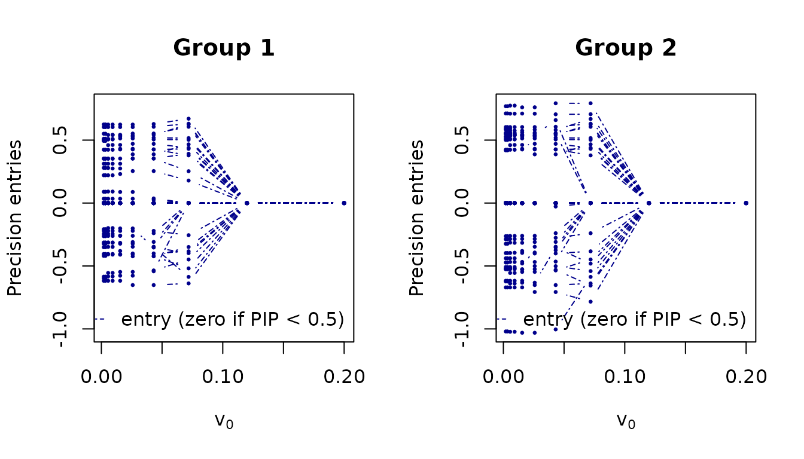
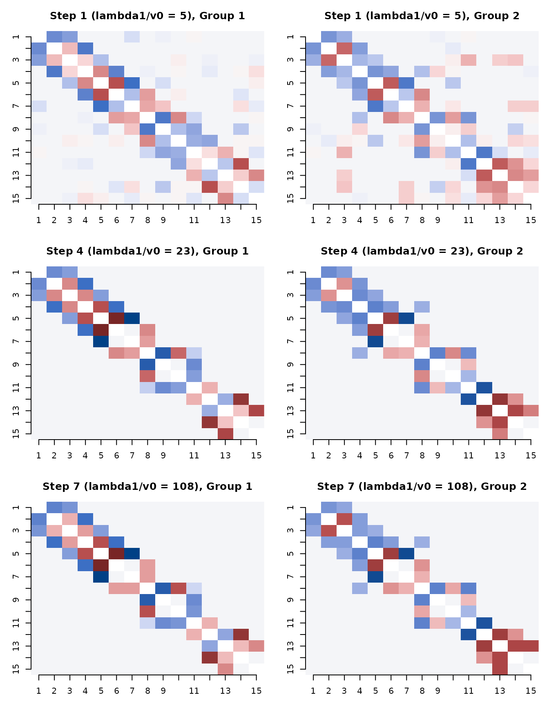
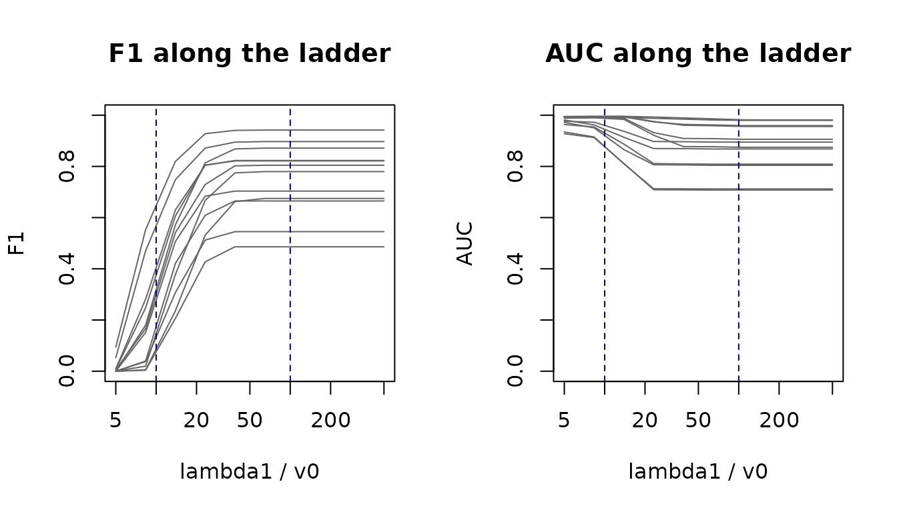

# Parameter exploration: understanding the v0 ladder

## Introduction

The spike variance `v0` controls sparsity in SSJGL, together with
`lambda1`. This vignette explains what `v0` means in the model, shows
how the estimated graph changes along a ladder of `v0` values, and
summarises the simulation study behind the default ladder,
`v0s = make_v0_ladder(lambda1)`.

## The spike-and-slab prior on edges

In SSJGL (Li et al., 2019) the spike and the slab are both **Laplace**
(double-exponential) priors on the off-diagonal **precision** entries
$`\omega^{(g)}_{jk}`$, not normal priors on partial correlations. For an
edge $`(j, k)`$ with inclusion indicator $`\delta_{jk}`$, the sparsity
part of the prior is

``` math
p(\omega^{(1)}_{jk}, \dots, \omega^{(G)}_{jk} \mid \delta_{jk})
\propto \prod_{g=1}^{G} \frac{\lambda_1}{v_{\delta}}
\exp\!\left(-\frac{\lambda_1}{v_{\delta}} |\omega^{(g)}_{jk}|\right),
\qquad v_{\delta} = \begin{cases} v_0 & \delta_{jk} = 0 \text{ (spike)} \\
v_1 & \delta_{jk} = 1 \text{ (slab)} \end{cases}
```

and the similarity part has the same form with `lambda2` and the fused
or group penalty. So:

- The spike has **rate** `lambda1/v0` and **scale** `v0/lambda1` on the
  precision entries. `v0` only matters through the ratio `lambda1/v0`,
  which is how
  [`make_v0_ladder()`](https://mljaniczek.github.io/spikeyglass/reference/make_v0_ladder.md)
  is parameterised. `sqrt(v0)` is not a standard deviation of anything
  in the model.
- The slab (`v1 = 1`) has rate `lambda1`: a weak penalty that hardly
  shrinks real edges.

### What `lambda1/v0` does in the EM

**E-step.** The posterior log-odds that an edge is in the slab is, for
the single spike-and-slab prior,

``` math
\operatorname{logit} P(\delta_{jk} = 1)
= \operatorname{logit}\pi_\delta - (G + c)\log\frac{v_1}{v_0}
+ \left(\lambda_1 \sum_g |\omega^{(g)}_{jk}| + \lambda_2\,\mathrm{pen}_{jk}\right)
\left(\frac{1}{v_0} - \frac{1}{v_1}\right),
```

where $`c = G(G-1)/2`$ for the fused penalty and $`c = 1`$ for the group
penalty. An edge whose estimate is exactly zero therefore has PIP
$`\approx \pi_\delta (v_0/v_1)^{G+c} / (1 - \pi_\delta)`$, which is
tiny, while any clearly non-zero entry gets a PIP near 1. **As
`lambda1/v0` grows, the PIPs become almost binary and simply mark the
support of the estimated precision matrices.**

**M-step.** The M-step solves the joint graphical lasso
$`\sum_g n_g [\operatorname{tr}(S_g\Omega_g) - \log\det\Omega_g]`$ plus
edge-wise penalties, with weight about `lambda1/v0` for spike edges and
`lambda1/v1` for slab edges. A spike edge is soft-thresholded at about
`lambda1/(n v0)` on the scale of the sample covariance, which is the
sample correlation for standardised data. For example, with `n = 100`:

``` r

library(spikeyglass)

v0s <- make_v0_ladder(lambda1 = 1)   # the default ladder at lambda1 = 1
data.frame(
  step = seq_along(v0s),
  v0 = signif(v0s, 3),
  ratio = round(1 / v0s, 1),                    # lambda1 / v0
  spike_scale = signif(v0s / 1, 3),             # v0 / lambda1
  threshold_n100 = round(1 / (100 * v0s), 3)    # lambda1 / (n v0), n = 100
)
#>   step     v0 ratio spike_scale threshold_n100
#> 1    1 0.1000  10.0      0.1000          0.100
#> 2    2 0.0316  31.6      0.0316          0.316
#> 3    3 0.0100 100.0      0.0100          1.000
```

### Standardise your data

Because the prior acts on precision entries, the meaning of `lambda1`
and `v0` depends on the variables’ units. Fit with `standardize = TRUE`
so that every variable has unit variance within each group. Then
`lambda1 = 1` (the value used by Li et al., 2019) and the default ladder
are sensible starting points. `normalize = TRUE` only centres the data
and does not change the estimates. It is kept for back-compatibility.

## Simulate data

We generate K = 2 groups with p = 15 variables using a band graph:

``` r

sim <- simulate_ssjgl_data(
  K = 2, p = 15, n = 100,
  graph_type = "band",
  perturb_prob = 0.05,
  signal = 0.3,
  seed = 42
)
```

### True partial correlations

The banded structure creates edges on the first and second
off-diagonals:

``` r

true_pcor <- lapply(sim$Omega_list, precision_to_pcor)

par(mfrow = c(1, 2))
for (k in 1:2) {
  mat <- true_pcor[[k]]
  diag(mat) <- NA
  image(1:15, 1:15, t(mat[15:1, ]),
        col = hcl.colors(50, "Blue-Red 3"),
        zlim = c(-0.5, 0.5),
        main = paste("True Partial Correlations: Group", k),
        xlab = "Variable", ylab = "Variable", axes = FALSE)
  axis(1, at = 1:15); axis(2, at = 1:15, labels = 15:1)
}
```



## Fitting across a long v0 ladder

To see the whole path, we use a 10-step exploration ladder with
`lambda1/v0` from 5 to 500. The default ladder covers 10 to 100 in three
steps.

``` r

v0s <- make_v0_ladder(lambda1 = 1, n_steps = 10, min_ratio = 5, max_ratio = 500)
data.frame(step = 1:10, v0 = signif(v0s, 3), ratio = round(1 / v0s, 1))
#>    step      v0 ratio
#> 1     1 0.20000   5.0
#> 2     2 0.12000   8.3
#> 3     3 0.07190  13.9
#> 4     4 0.04310  23.2
#> 5     5 0.02580  38.7
#> 6     6 0.01550  64.6
#> 7     7 0.00928 107.7
#> 8     8 0.00557 179.7
#> 9     9 0.00334 299.7
#> 10   10 0.00200 500.0
```

``` r

fit <- ssjgl(
  Y = sim$data_list,
  penalty = "fused",
  lambda0 = 1,
  lambda1 = 1,
  lambda2 = 1,
  v0s = v0s,
  doubly = TRUE,
  a = 1, b = 15,
  maxitr.em = 100,
  tol.em = 1e-4,
  standardize = TRUE,
  impute = FALSE
)
```

## How the solution evolves across v0

### Edge counts and inclusion probabilities

``` r

plot_stability(fit)   # uses fit$v0s
```



### Solution path

The solution path shows how individual precision matrix entries are
shrunk as v0 decreases:

``` r

plot_path(fit$v0s, fit, thres = 0.5, normalize = FALSE,
          xlab = expression(v[0]), ylab = "Precision entries",
          main = c("Group 1", "Group 2"), par = c(1, 2))
```



## Comparing estimates along the ladder

We compare the estimated partial correlations at the first step
(`lambda1/v0 = 5`), an intermediate step, and step 7 (`lambda1/v0` about
108, close to the end of the default ladder).

``` r

steps_to_show <- c(1, 4, 7)
step_labels <- sprintf("Step %d (lambda1/v0 = %.0f)", steps_to_show,
                       1 / v0s[steps_to_show])

par(mfrow = c(3, 2), mar = c(3, 3, 3, 1))
for (idx in seq_along(steps_to_show)) {
  s <- steps_to_show[idx]
  for (k in 1:2) {
    pcor_est <- precision_to_pcor(fit$thetalist[[s]][[k]])
    diag(pcor_est) <- NA
    image(1:15, 1:15, t(pcor_est[15:1, ]),
          col = hcl.colors(50, "Blue-Red 3"),
          zlim = c(-0.5, 0.5),
          main = sprintf("%s, Group %d", step_labels[idx], k),
          xlab = "", ylab = "", axes = FALSE)
    axis(1, at = 1:15); axis(2, at = 1:15, labels = 15:1)
  }
}
```



### Performance at each step

``` r

perf <- t(sapply(seq_along(v0s), function(s) {
  m <- compute_metrics(fit, sim$adj_list, sim$Omega_list, v0_index = s)
  pr <- fit$problist1[[s]][upper.tri(fit$problist1[[s]])]
  c(ratio = 1 / v0s[s],
    AUC = m$overall$mean_AUC,
    F1 = mean(sapply(m$per_group, function(g) g$F1)),
    edges = sum(pr > 0.5),
    uncertain = sum(pr > 0.1 & pr < 0.9))
}))
round(perf, 3)
#>         ratio   AUC    F1 edges uncertain
#>  [1,]   5.000 0.990    NA     0         0
#>  [2,]   8.341 0.983    NA     0         0
#>  [3,]  13.913 0.958 0.841    21         0
#>  [4,]  23.208 0.948 0.913    29         0
#>  [5,]  38.713 0.948 0.913    29         0
#>  [6,]  64.577 0.942 0.913    29         0
#>  [7,] 107.722 0.941 0.913    29         0
#>  [8,] 179.691 0.943 0.913    29         0
#>  [9,] 299.742 0.935 0.913    29         0
#> [10,] 500.000 0.938 0.913    29         0
```

Early steps (small `lambda1/v0`) give graded PIPs and a high AUC, but
select few edges at PIP \> 0.5. As `lambda1/v0` grows, more PIPs move to
0 or 1. The edge set then stops changing, and F1 at PIP \> 0.5 reaches
its plateau.

## Which ladder? A simulation study

Three ladder rules were in use: the old default `c(0.1, 0.03, 0.01)`;
the old
[`make_v0_ladder()`](https://mljaniczek.github.io/spikeyglass/reference/make_v0_ladder.md)
default (10 steps, `lambda1/v0` from 5 to 500); and the rule
`v0 = lambda1 / (lambda1 + 5k)`, k = 1, 2, 3, used in some applied work.
We compared them on standardised data from
[`simulate_ssjgl_data()`](https://mljaniczek.github.io/spikeyglass/reference/simulate_ssjgl_data.md):
K = 2, p in {20, 50, 100}, n in {100, 300} per group, band and
scale-free graphs, and 10 replicates per setting. All fits used the
fused penalty, `lambda0 = lambda1 = lambda2 = 1` and `b = p`. At
`lambda1 = 1` the three rules end at `lambda1/v0` = 100, 500 and 16. The
script is `data-raw/v0-ladder-study.R` in the package sources.

Final-step results, averaged over replicates. F1 is at PIP \> 0.5,
`jaccard_prev` is the overlap of the selected edge set with the previous
step’s (1 = the path has stabilised), and `total_seconds` is the time
per fit:

``` r

study <- read.csv(system.file("extdata", "v0_ladder_study.csv",
                              package = "spikeyglass"))
study$rule <- factor(study$rule, c("old_default", "make_v0_ladder", "dina"),
                     c("c(.1,.03,.01)", "5-500 (10 steps)", "1/(1+5k)"))
knitr::kable(study[, c("p", "n", "graph", "rule", "AUC", "F1", "edges",
                       "true_edges", "jaccard_prev", "total_seconds")],
             digits = c(0, 0, 0, 0, 3, 3, 0, 0, 2, 0), row.names = FALSE)
```

| p | n | graph | rule | AUC | F1 | edges | true_edges | jaccard_prev | total_seconds |
|---:|---:|:---|:---|---:|---:|---:|---:|---:|---:|
| 20 | 100 | band | 1/(1+5k) | 0.894 | 0.671 | 24 | 40 | 0.65 | 15 |
| 20 | 100 | band | 5-500 (10 steps) | 0.868 | 0.823 | 34 | 40 | 1.00 | 19 |
| 20 | 100 | band | c(.1,.03,.01) | 0.929 | 0.873 | 43 | 40 | 1.00 | 9 |
| 20 | 100 | scale-free | 1/(1+5k) | 0.917 | 0.648 | 13 | 22 | 0.53 | 13 |
| 20 | 100 | scale-free | 5-500 (10 steps) | 0.895 | 0.821 | 21 | 22 | 1.00 | 12 |
| 20 | 100 | scale-free | c(.1,.03,.01) | 0.924 | 0.801 | 27 | 22 | 1.00 | 7 |
| 20 | 300 | band | 1/(1+5k) | 0.991 | 0.879 | 36 | 40 | 0.71 | 16 |
| 20 | 300 | band | 5-500 (10 steps) | 0.980 | 0.942 | 43 | 40 | 1.00 | 18 |
| 20 | 300 | band | c(.1,.03,.01) | 0.979 | 0.940 | 44 | 40 | 1.00 | 7 |
| 20 | 300 | scale-free | 1/(1+5k) | 0.995 | 0.785 | 17 | 22 | 0.70 | 11 |
| 20 | 300 | scale-free | 5-500 (10 steps) | 0.982 | 0.897 | 26 | 22 | 1.00 | 16 |
| 20 | 300 | scale-free | c(.1,.03,.01) | 0.978 | 0.897 | 26 | 22 | 0.99 | 6 |
| 50 | 100 | band | 1/(1+5k) | 0.832 | 0.560 | 54 | 122 | 0.54 | 99 |
| 50 | 100 | band | 5-500 (10 steps) | 0.804 | 0.704 | 89 | 122 | 1.00 | 658 |
| 50 | 100 | band | c(.1,.03,.01) | 0.883 | 0.745 | 136 | 122 | 1.00 | 112 |
| 50 | 100 | scale-free | 1/(1+5k) | 0.852 | 0.478 | 31 | 78 | 0.38 | 113 |
| 50 | 100 | scale-free | 5-500 (10 steps) | 0.809 | 0.665 | 60 | 78 | 1.00 | 663 |
| 50 | 100 | scale-free | c(.1,.03,.01) | 0.872 | 0.643 | 100 | 78 | 1.00 | 92 |
| 50 | 300 | band | 1/(1+5k) | 0.991 | 0.649 | 64 | 121 | 0.45 | 90 |
| 50 | 300 | band | 5-500 (10 steps) | 0.959 | 0.871 | 136 | 121 | 1.00 | 110 |
| 50 | 300 | band | c(.1,.03,.01) | 0.964 | 0.871 | 139 | 121 | 0.98 | 58 |
| 50 | 300 | scale-free | 1/(1+5k) | 0.994 | 0.609 | 37 | 75 | 0.44 | 67 |
| 50 | 300 | scale-free | 5-500 (10 steps) | 0.956 | 0.805 | 92 | 75 | 1.00 | 84 |
| 50 | 300 | scale-free | c(.1,.03,.01) | 0.952 | 0.802 | 90 | 75 | 0.97 | 38 |
| 100 | 100 | band | 1/(1+5k) | 0.771 | 0.381 | 74 | 310 | 0.35 | 424 |
| 100 | 100 | band | 5-500 (10 steps) | 0.712 | 0.545 | 148 | 310 | 1.00 | 1087 |
| 100 | 100 | band | c(.1,.03,.01) | 0.815 | 0.608 | 315 | 310 | 1.00 | 391 |
| 100 | 100 | scale-free | 1/(1+5k) | 0.767 | 0.286 | 34 | 214 | 0.19 | 320 |
| 100 | 100 | scale-free | 5-500 (10 steps) | 0.708 | 0.486 | 104 | 214 | 1.00 | 953 |
| 100 | 100 | scale-free | c(.1,.03,.01) | 0.788 | 0.489 | 237 | 214 | 1.00 | 303 |
| 100 | 300 | band | 1/(1+5k) | 0.982 | 0.485 | 94 | 307 | 0.28 | 917 |
| 100 | 300 | band | 5-500 (10 steps) | 0.906 | 0.780 | 304 | 307 | 1.00 | 588 |
| 100 | 300 | band | c(.1,.03,.01) | 0.918 | 0.786 | 316 | 307 | 0.96 | 291 |
| 100 | 300 | scale-free | 1/(1+5k) | 0.977 | 0.330 | 34 | 215 | 0.27 | 352 |
| 100 | 300 | scale-free | 5-500 (10 steps) | 0.875 | 0.675 | 200 | 215 | 1.00 | 1587 |
| 100 | 300 | scale-free | c(.1,.03,.01) | 0.880 | 0.682 | 199 | 215 | 0.91 | 254 |

Averaged over all settings:

``` r

aggregate(cbind(AUC, F1, jaccard_prev, total_seconds) ~ rule, data = study,
          FUN = function(x) round(mean(x), 3))
#>               rule   AUC    F1 jaccard_prev total_seconds
#> 1    c(.1,.03,.01) 0.907 0.761        0.984       130.610
#> 2 5-500 (10 steps) 0.871 0.751        1.000       482.913
#> 3         1/(1+5k) 0.914 0.563        0.456       203.047
```

Along the 10-step ladder, performance as a function of `lambda1/v0`
(mean over replicates; one line per setting):

``` r

byr <- read.csv(system.file("extdata", "v0_ladder_study_by_ratio.csv",
                            package = "spikeyglass"))
byr$setting <- interaction(byr$p, byr$n, byr$graph)
par(mfrow = c(1, 2))
for (what in c("F1", "AUC")) {
  plot(NA, xlim = range(byr$ratio), ylim = c(0, 1), log = "x",
       xlab = "lambda1 / v0", ylab = what, main = paste(what, "along the ladder"))
  for (s in levels(byr$setting)) {
    d <- byr[byr$setting == s, ]
    lines(d$ratio, d[[what]], col = "grey40")
  }
  abline(v = c(10, 100), lty = 2, col = "darkblue")
}
```



### Conclusions

- **`v0 = lambda1/(lambda1 + 5k)`, ending at `lambda1/v0 = 16`, stops
  too early.** It has the highest AUC, because its PIPs are still
  graded. But at PIP \> 0.5 it selects far fewer edges than the truth
  (e.g. 74 of 310 at p = 100, n = 100, band), so its F1 is the lowest in
  every setting (0.56 on average, against 0.76). Its path has not
  stabilised either: the last two steps share only 20-70% of their
  selected edges.
- **The 10-step ladder to `lambda1/v0 = 500` gives no benefit for its
  cost.** Along it, F1 reaches its plateau by `lambda1/v0` of about 40,
  and nothing changes after about 65. Meanwhile AUC falls (from 0.93 to
  0.71 at p = 100, n = 100) as the PIPs become binary. Its final F1 was
  within 0.01 of the 3-step ladder’s at n = 300. At n = 100 it ranged
  from 0.06 lower to 0.02 higher (p = 100, band: F1 0.55 vs 0.61, AUC
  0.71 vs 0.82). Its AUC was lower in every n = 100 setting. At n = 100
  and p \>= 50 it also under-selected (e.g. 148 edges against 310 true
  at p = 100, band). It took 1.8 to 7 times as long (median 2.7).
- **The 3-step ladder from `lambda1/v0 = 10` to `100` (the old default
  at `lambda1 = 1`) had the best F1 on average (0.76), and was best or
  within 0.02 of the best in every setting.** At n = 100 its AUC was
  clearly higher than the long ladder’s (by 0.03 to 0.10), and at n =
  300 the two were within about 0.01. Its final step had stabilised
  (Jaccard with the previous step 0.91 to 1.00).

So the default is `v0s = make_v0_ladder(lambda1)`, the 3-step ladder
with `lambda1/v0 = 10, 31.6, 100`. Defining it through `lambda1/v0`
keeps it consistent when `lambda1` is changed. Timings in the table are
wall-clock seconds with 7 fits running at once on an 8-core laptop, so
compare them within a row only.

## When to deviate from the default

- **Graded PIPs for ranking.** If you want to rank edges (e.g. for an
  ROC curve or an FDR-type analysis) rather than select them, look at
  the earlier steps of a longer ladder (`lambda1/v0` around 5 to 20),
  where the PIPs are less binary.
- **Exploration.** Use
  `make_v0_ladder(lambda1, n_steps = 10, min_ratio = 5, max_ratio = 500)`
  with
  [`plot_stability()`](https://mljaniczek.github.io/spikeyglass/reference/plot_stability.md)
  and
  [`plot_path()`](https://mljaniczek.github.io/spikeyglass/reference/plot_path.md)
  to check that the path has stabilised by the end of the ladder.
- **Cross-validation.**
  [`SSJGL_select_v0_cv()`](https://mljaniczek.github.io/spikeyglass/reference/SSJGL_select_v0_cv.md)
  selects `v0` by held-out likelihood. Note that it fits each `v0` from
  a cold start, without the ladder.
- **Unstandardised data.** If you fit on the original scale, the same
  `lambda1/v0` means different things for different variables. Prefer
  `standardize = TRUE`.

## References

Li, Z. R., McCormick, T. H., & Clark, S. J. (2019). Bayesian Joint
Spike-and-Slab Graphical Lasso. *Proceedings of the 36th International
Conference on Machine Learning (ICML)*, PMLR 97:3877–3885.

Ročková, V., & George, E. I. (2018). The spike-and-slab LASSO. *Journal
of the American Statistical Association*, 113(521), 431–444.
