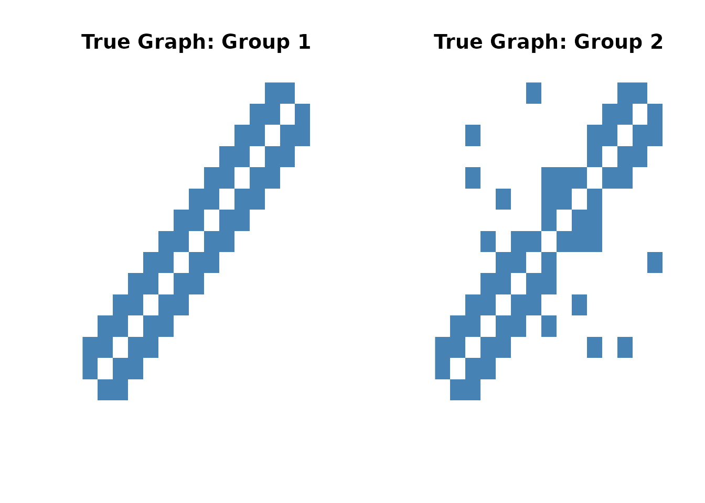
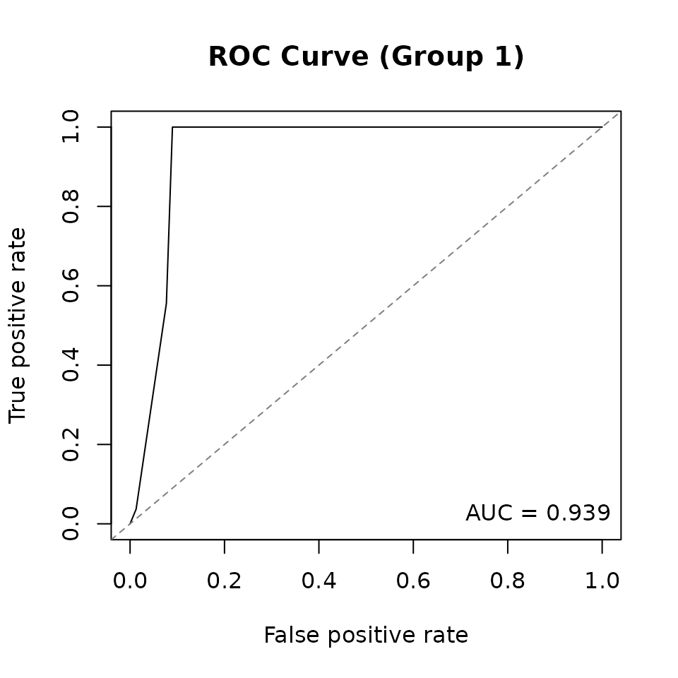
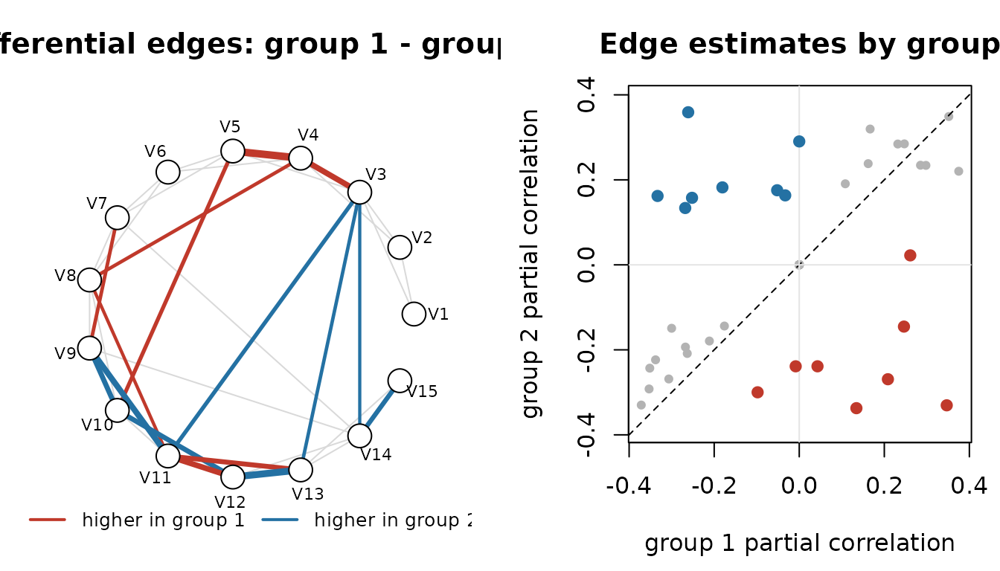

# Using spike-and-slab joint graphical lasso

## Introduction

The `spikeyglass` package implements the Bayesian Spike-and-Slab Joint
Graphical Lasso (SSJGL) from Li et al. (2019). This method estimates
multiple related precision matrices (inverse covariance matrices) across
K groups simultaneously, encouraging shared sparsity structure while
allowing group-specific differences.

Key features:

- **Adaptive penalization**: spike-and-slab priors automatically
  determine edge-specific penalty weights
- **Two penalty types**: fused (penalizes pairwise differences) and
  group (penalizes L2 norm across groups)
- **Posterior edge probabilities**: each edge gets a posterior inclusion
  probability P(delta = 1), enabling principled edge selection
- **Missing data handling**: built-in imputation via conditional MVN

## Simulate data

We generate a small synthetic example with K=2 groups and p=15 variables
using a banded (AR-2) graph with a few differential edges.

``` r

library(spikeyglass)

sim <- simulate_ssjgl_data(
  K = 2, p = 15, n = 100,
  graph_type = "band",
  perturb_prob = 0.05,
  signal = 0.3,
  seed = 42
)

# True adjacency matrices
cat("Group 1 edges:", sum(sim$adj_list[[1]][upper.tri(sim$adj_list[[1]])]), "\n")
#> Group 1 edges: 27
cat("Group 2 edges:", sum(sim$adj_list[[2]][upper.tri(sim$adj_list[[2]])]), "\n")
#> Group 2 edges: 31

# Visualize true graph structures
par(mfrow = c(1, 2))
image(sim$adj_list[[1]], main = "True Graph: Group 1",
      col = c("white", "steelblue"), axes = FALSE)
image(sim$adj_list[[2]], main = "True Graph: Group 2",
      col = c("white", "steelblue"), axes = FALSE)
```



## Choosing hyperparameters

SSJGL has three penalty parameters (`lambda0`, `lambda1`, `lambda2`) and
a ladder of spike variances `v0s`.

### Standardise the data

The priors act on the entries of the precision matrices, so their
meaning depends on the variables’ units. Use `standardize = TRUE`, which
centres and scales every variable to unit variance within each group.
The estimates are then precision matrices of the standardised variables.
(`normalize = TRUE` only centres the data and does not change the
estimates.)

### Lambda parameters

The spike-and-slab E-step produces adaptive, edge-specific penalty
weights that multiply `lambda1` and `lambda2`. With standardised data:

1.  **lambda1 = 1** (as in Li et al., 2019). `lambda1` and `v0` act
    together through the ratio `lambda1/v0` (see below).

2.  **lambda2** controls the cross-group similarity penalty.

    - `lambda2 = 0`: no borrowing across groups (separate estimation)
    - `lambda2 = lambda1`: equal weight on sparsity and similarity
    - `lambda2 > lambda1`: encourage more similar graphs across groups

3.  **lambda0**: diagonal penalty. Use `lambda0 = 1` (the method is
    insensitive to it).

### Understanding v0: the spike

Each off-diagonal precision entry has a **Laplace** prior: rate
`lambda1/v0` in the spike (the edge is absent) and `lambda1/v1` in the
slab (the edge is present, `v1 = 1`). The spike’s scale is therefore
`v0/lambda1`, and only the ratio `lambda1/v0` matters. Larger
`lambda1/v0` means stronger shrinkage of non-edges. In the M-step, a
spike edge is soft-thresholded at roughly `lambda1/(n v0)` on the
correlation scale.

### The v0 ladder (warm-starting)

The EM is run along a **decreasing** ladder of `v0` (increasing
`lambda1/v0`), each step warm-started from the previous one (“dynamic
posterior exploration”, Li et al., 2019). The default,
`v0s = make_v0_ladder(lambda1)`, has three steps with
`lambda1/v0 = 10, 31.6, 100`, which is `c(0.1, 0.0316, 0.01)` at
`lambda1 = 1`. It was chosen by the simulation study summarised in
[`vignette("parameter-exploration")`](https://mljaniczek.github.io/spikeyglass/articles/parameter-exploration.md).
That vignette also shows how to explore longer ladders.

## Fit the model

``` r

fit <- ssjgl(
  Y = sim$data_list,
  penalty = "fused",
  lambda0 = 1,
  lambda1 = 1,
  lambda2 = 1,
  doubly = TRUE,
  a = 1, b = 15,
  maxitr.em = 100,
  tol.em = 1e-4,
  standardize = TRUE,
  impute = FALSE
)
```

The fitted object records its settings, e.g. the ladder that was used:

``` r

fit$v0s
#> [1] 0.10000000 0.03162278 0.01000000
```

``` r

print(fit)
#> Spike-and-Slab Joint Graphical Lasso (SSJGL)
#>   Groups (K): 2
#>   Variables (p): 15
#>   v0 ladder steps: 3
#>   Total EM iterations: 37
#>   Total time: 0.8 seconds
#>   Group 1: 30 non-zero edges (from precision)
#>   Group 2: 31 non-zero edges (from precision)
#>   Edges with P(inclusion) > 0.5: 32
```

## Extract results

``` r

# Precision matrices at the final v0 step
theta_hat <- coef(fit)

# Partial correlations
pcor_hat <- fitted(fit)

# Edge inclusion probabilities
probs <- extract_probabilities(fit)

# Binary adjacency from thresholding inclusion probabilities at 0.5
adj_hat <- extract_adjacency(fit, threshold = 0.5)

cat("Estimated edges (Group 1):",
    sum(adj_hat[[1]][upper.tri(adj_hat[[1]])]), "\n")
#> Estimated edges (Group 1): 32
cat("Estimated edges (Group 2):",
    sum(adj_hat[[2]][upper.tri(adj_hat[[2]])]), "\n")
#> Estimated edges (Group 2): 32
```

## Evaluate performance

Compare the estimated graphs to the truth using TPR, FPR, and AUC:

``` r

metrics <- compute_metrics(
  fit = fit,
  true_adj = sim$adj_list,
  true_omega = sim$Omega_list,
  threshold = 0.5
)

cat("=== Overall Performance ===\n")
#> === Overall Performance ===
cat(sprintf("Mean TPR: %.3f\n", metrics$overall$mean_TPR))
#> Mean TPR: 0.931
cat(sprintf("Mean FPR: %.3f\n", metrics$overall$mean_FPR))
#> Mean FPR: 0.065
cat(sprintf("Mean AUC: %.3f\n", metrics$overall$mean_AUC))
#> Mean AUC: 0.934

for (k in 1:2) {
  cat(sprintf("\n--- Group %d ---\n", k))
  g <- metrics$per_group[[k]]
  cat(sprintf("  TP=%d, FP=%d, TN=%d, FN=%d\n", g$TP, g$FP, g$TN, g$FN))
  cat(sprintf("  TPR=%.3f, FPR=%.3f, F1=%.3f\n", g$TPR, g$FPR, g$F1))
  cat(sprintf("  Frobenius norm: %.3f\n", g$frobenius_norm))
}
#> 
#> --- Group 1 ---
#>   TP=25, FP=7, TN=71, FN=2
#>   TPR=0.926, FPR=0.090, F1=0.847
#>   Frobenius norm: 2.240
#> 
#> --- Group 2 ---
#>   TP=29, FP=3, TN=71, FN=2
#>   TPR=0.935, FPR=0.041, F1=0.921
#>   Frobenius norm: 4.708
```

### ROC curve

``` r

plot_roc(metrics$roc[[1]], main = "ROC Curve (Group 1)")
```



## Differential edges

[`diff_edges()`](https://mljaniczek.github.io/spikeyglass/reference/diff_edges.md)
tests which edges differ between two groups. With
`method = "permutation"` (the default) it pools the rows of the two
groups, shuffles the group labels `B` times, and refits
[`ssjgl()`](https://mljaniczek.github.io/spikeyglass/reference/ssjgl.md)
with the settings stored in the fit. The null scores \|Δ\| are pooled
across all edges and permutations, and the resulting p-values are
adjusted by Benjamini-Hochberg. Here Δ is the difference in partial
correlations, group 1 minus group 2. `method = "bootstrap"` gives
percentile intervals for Δ instead.

Each refit repeats the whole v0 ladder, so this is the slow step. If the
**future.apply** package is installed, the refits run in parallel under
any
[`future::plan()`](https://future.futureverse.org/reference/plan.html),
e.g. `future::plan(future::multisession, workers = 4)`. Results depend
only on [`set.seed()`](https://rdrr.io/r/base/Random.html), not on the
plan.

``` r

set.seed(1)
de <- diff_edges(fit, Y = sim$data_list, B = 20)
de
#> <ssjgl_diff_edges>
#>   group 1 vs group 2, pcor scale, permutation (B = 20), v0 step 3
#>   12 of 105 edges selected at BH-adjusted p < 0.05
#>   i  j node1 node2   est_g1 est_g2   diff   pvalue   p_adj selected
#>   4  5    V4    V5  0.29123 -0.328  0.619 0.000476 0.00555     TRUE
#>   3  4    V3    V4  0.29342 -0.314  0.607 0.000476 0.00555     TRUE
#>   9 10    V9   V10 -0.37791  0.207 -0.585 0.000476 0.00555     TRUE
#>  11 13   V11   V13  0.18953 -0.379  0.568 0.000476 0.00555     TRUE
#>  12 13   V12   V13 -0.24371  0.305 -0.549 0.000476 0.00555     TRUE
#>   9 11    V9   V11 -0.23151  0.279 -0.510 0.000476 0.00555     TRUE
#>  14 15   V14   V15 -0.17495  0.235 -0.410 0.000476 0.00555     TRUE
#>   3 13    V3   V13 -0.02633  0.328 -0.354 0.000476 0.00555     TRUE
#>   7  9    V7    V9  0.35160  0.000  0.352 0.000476 0.00555     TRUE
#>   3 11    V3   V11  0.00814  0.299 -0.290 0.002380 0.02499     TRUE
#>  prob_dissimilar
#>                1
#>                1
#>                1
#>                1
#>                1
#>                1
#>                1
#>                1
#>                1
#>                1
#>   ... and 2 more
```

The result is a data frame with one row per edge (`i`, `j`, `node1`,
`node2`, `est_g1`, `est_g2`, `diff`, `pvalue`, `p_adj`, `selected`).
Where the concepts match, the column names are those used by multiGGMr’s
`diff_summary()`/`select_diff_edges()`. The plot shows the selected
edges, coloured by direction, and the group 1 vs group 2 partial
correlations:

``` r

plot(de)
```



Because this fit uses `doubly = TRUE`, the table also has
`prob_dissimilar`, the EM’s P(ξ = 1) for each edge. It indicates that
the edge is only weakly shrunk towards equality across groups. It is not
a calibrated probability that the edge differs, and in real data it can
be close to 1 for every included edge. Use the permutation p-values for
inference.

`B = 20` keeps this vignette fast. Use `B = 100` or more in practice:
with pooled nulls the smallest attainable p-value is about 1 / (B ×
number of edges), but BH needs enough permutations to be stable.

## Select v0 via cross-validation

For real data where the truth is unknown, use cross-validation to select
the best v0. This evaluates each v0 independently using held-out
Gaussian negative log-likelihood:

``` r

v0s_cv <- make_v0_ladder(lambda1 = 1, n_steps = 8, min_ratio = 5, max_ratio = 500)

cv_res <- SSJGL_select_v0_cv(
  Y = lapply(sim$data_list, scale),
  v0s = v0s_cv,
  folds = 3,
  penalty = "fused",
  lambda0 = 1, lambda1 = 1, lambda2 = 1,
  maxitr.em = 50, maxitr.jgl = 50
)
cat("Best v0:", cv_res$v0_best, "\n")
```

## Bootstrap confidence intervals

The `SSJGL_final_with_pcor_CI` function computes bootstrap confidence
intervals for partial correlations at a given v0:

``` r

boot_res <- SSJGL_final_with_pcor_CI(
  Y = lapply(sim$data_list, scale),
  v0_best = 0.01,
  B = 50,
  ci_level = 0.95,
  penalty = "fused",
  lambda0 = 1, lambda1 = 1, lambda2 = 1
)

# Partial correlation point estimate for group 1
pcor_g1 <- boot_res$pcor_hat[[1]]

# 95% CI bounds
lo <- boot_res$CI_lower[[1]]
hi <- boot_res$CI_upper[[1]]

# Edges where CI excludes zero
significant_edges <- (lo > 0 | hi < 0)
diag(significant_edges) <- FALSE
cat("Significant edges (Group 1):",
    sum(significant_edges[upper.tri(significant_edges)]), "\n")
```

## Tuning summary

| Parameter | Role | Guidance |
|----|----|----|
| `standardize` | Centre and scale each variable | `TRUE` unless variables share a meaningful scale |
| `lambda0` | Diagonal penalty | Use 1 (insensitive) |
| `lambda1` | Edge sparsity (with `v0`) | 1 with standardised data |
| `lambda2` | Cross-group similarity | 0 (separate) to `lambda1` or more (more borrowing) |
| `v0s` | Spike ladder; spike rate `lambda1/v0` | Default `make_v0_ladder(lambda1)`: `lambda1/v0` = 10, 31.6, 100 |
| `v1` | Slab variance | Leave at 1 |
| `a, b` | Beta prior for pi | `a = 1, b = p` for a sparse prior |
| `doubly` | Doubly spike-and-slab | TRUE recommended for multi-group |

**Recommended workflow:**

1.  Fit with `standardize = TRUE`, `lambda0 = 1`, `lambda1 = 1`.
2.  Set `lambda2 = lambda1` as a starting point, and adjust it for more
    or less cross-group similarity.
3.  Keep the default ladder (`v0s` not given). Check with
    [`plot_stability()`](https://mljaniczek.github.io/spikeyglass/reference/plot_stability.md)
    on a longer ladder if in doubt.
4.  Select edges by thresholding posterior probabilities at 0.5.
5.  For real data, use
    [`SSJGL_select_v0_cv()`](https://mljaniczek.github.io/spikeyglass/reference/SSJGL_select_v0_cv.md)
    to check the v0 choice, or bootstrap CIs for edge-level inference.

## References

Li, Z. R., McCormick, T. H., & Clark, S. J. (2019). Bayesian Joint
Spike-and-Slab Graphical Lasso. *Proceedings of the 36th International
Conference on Machine Learning (ICML)*.
